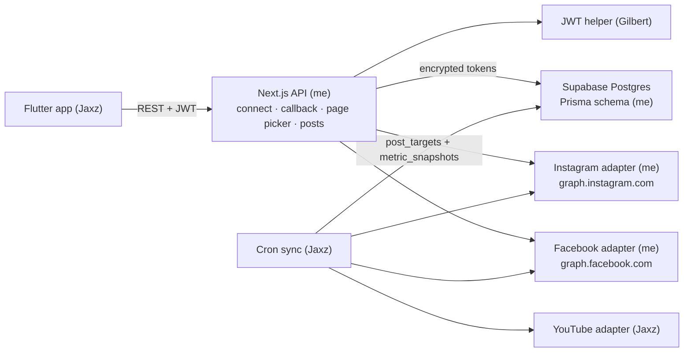
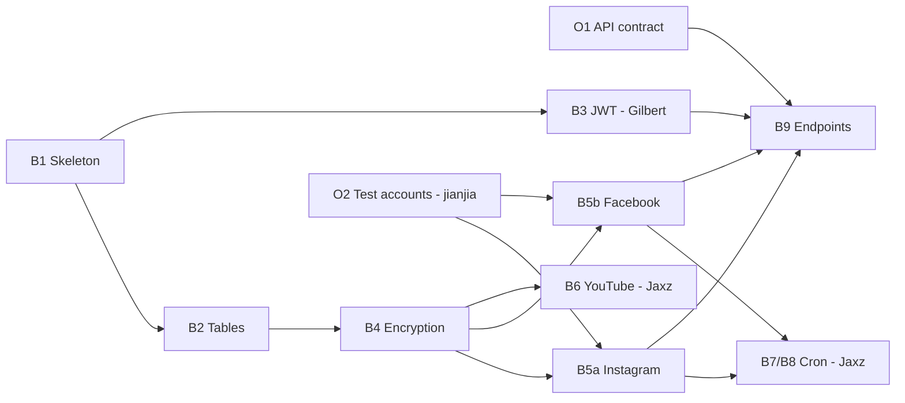

# Personal TRD: Jayci (M1 Backend)

| Field | Value |
|---|---|
| Owner | Jayci |
| Milestone | M1: account connection and data pull |
| My tasks | O1 (with Jaxz), B1, B2, B4, B5 (Instagram + Facebook), B9, mentoring jianjia on O2 and O3 |
| Based on | PRD v1.2, TRD v1.3, Prototype Blueprint v1.2, M1 Task Plan (Agenda) |
| Version | 2.0 |
| Last updated | 2026-10-21 |

The team TRD describes the whole system. This document covers only **my** part: what I build, in what order, how I build it and how I know it is done. Every new term is explained the first time it appears.

### Changes in v2.0

- TikTok removed from scope (PRD v1.1). The Facebook Page is now FR-4 and a Must in M1, so **B5 covers both Instagram and Facebook**, as the Agenda originally said.
- SME removed (PRD v1.2). `brands.type` is gone; one brand = one creator profile.
- New Facebook flow added: Facebook Login for Business, Page picker and Reels metrics.
- Schedule extended by three days to fit the Facebook adapter.

---

## 1. Alignment check: Agenda vs latest docs

The Agenda was written from PRD/TRD v0.1. Most of it still holds, but these points need a decision from Jaxz before I start B5.

| # | Agenda says | Latest docs say | What I do |
|---|---|---|---|
| 1 | M1 scope: FR-1, FR-2, FR-3, FR-8 | PRD v1.2 M1: FR-1, FR-2, FR-3, **FR-4**, FR-8 | Build Facebook Page connection in M1. B5 already says "FB + IG", so ownership stays with me |
| 2 | O2: "YouTube first, FB Page later" | FR-4 is in M1, and the demo needs a test Page **with post history** (Blueprint notes) | Ask jianjia to set up the Facebook test Page now, not later |
| 3 | Token encryption is "TR-15" | TRD v1.3: encryption is **TR-16**, TR-15 is billing | Use TR-16 in commits and docs |
| 4 | Not mentioned | TRD lists IG scopes `instagram_business_basic` and `instagram_business_content_publish` only | Media insights also need `instagram_business_manage_insights` [1], [2]. Ask Jaxz to add it to the TRD |
| 5 | Tables: users, brands, social_accounts, posts, metric_snapshots | TRD links snapshots to `post_targets`, not `posts` | Add `post_targets` and a small `oauth_states` table (section 6) |
| 6 | No owner for M0 (Meta App Review) | PRD M0: submit Meta App Review this week, owner TBD | I own both Meta adapters, so I am best placed to write the permission list. Offer to prepare it |
| 7 | No deployment owner | TRD: Railway | OAuth needs a public HTTPS callback, so I deploy inside B1 |
| 8 | Not mentioned | TRD: Instagram and Facebook use **different login flows** in one Meta app | Two OAuth flows, two sets of credentials. Plan time for both |

---

## 2. Scope of my work

### In scope (M1)

| Item | Implements |
|---|---|
| API contract shared with Flutter | Agenda O1 |
| Next.js API skeleton, adapter interface, Railway deploy | TR-1 (structure), TR-2 (interface) |
| Prisma schema and migration for M1 tables | TRD section 5 |
| AES-256-GCM token encryption | TR-16, NFR-3 |
| Instagram adapter: Instagram Login OAuth and metric fetch | FR-2, FR-8, TR-2 |
| Facebook adapter: Facebook Login for Business, Page picker and Reels metric fetch | FR-4, FR-8, TR-2 |
| OAuth and data endpoints for Flutter | FR-2, FR-4, FR-8 |
| Mentoring jianjia | Agenda O2, O3 |

### Out of scope for me in M1

| Item | Owner or milestone |
|---|---|
| JWT middleware | Gilbert (B3) |
| YouTube adapter | Jaxz (B6) |
| Cron sync every 6 hours and first 30-post pull | Jaxz (B7, B8). He calls my adapters |
| Token auto-refresh worker (TR-3) | Cut from M1 by the Agenda. User reconnects manually |
| Google login | Cut from M1 by the Agenda |
| Content Score and `content_scores` table | M2 |
| Publishing (`instagram_business_content_publish`, `pages_manage_posts`) | M3 |

---

## 3. How my part fits the system



The adapters are the shared piece. My API routes use them for login. Jaxz's cron uses them to pull data. So the adapter interface (section 5) is a contract between me and Jaxz, just like the API contract is a contract between me and Flutter.

---

## 4. Technical requirements (my part)

`JR` = Jayci requirement. Each one maps back to the team TRD or PRD.

| ID | Requirement | Maps to | Acceptance check |
|---|---|---|---|
| JR-1 | Every JSON field is camelCase, every date is ISO 8601 UTC, every error uses one shape | O1 | Jaxz builds all M1 screens from mock JSON with no changes after switching to the real API |
| JR-2 | All adapters implement one TypeScript interface | TR-2 | YouTube adapter compiles against the same interface |
| JR-3 | Schema supports YouTube, Facebook and Instagram; metric columns nullable | TRD 4, 5 | Migration runs on a fresh database; a missing metric is stored as `null` |
| JR-4 | Platform tokens encrypted with AES-256-GCM before saving; key only in env vars | TR-16, NFR-3 | Unit tests pass; the database column never contains a readable token |
| JR-5 | Instagram connects via Instagram Login; non-professional accounts get a clear error | FR-2 | Test Creator account connects; personal account is rejected with `IG_NOT_PROFESSIONAL` |
| JR-6 | Instagram fetch returns last 30 media with views, likes, comments, shares and saves | FR-8 | Up to 30 posts returned, `null` where data is missing |
| JR-7 | Facebook connects via Facebook Login for Business; user picks one Page | FR-4 | Test Page connects; Page ID stored as `external_id` |
| JR-8 | Facebook fetch returns last 30 Reels with views, likes (all reactions), comments and shares; saves `null` | FR-8, TRD 4 | Up to 30 Reels returned with metrics |
| JR-9 | Expired or revoked token sets the account to `needs_reconnect` | FR-2, FR-4, Agenda | Revoking access in the platform makes the Reconnect button appear |
| JR-10 | No token ever appears in an API response or a log | NFR-3 | Grep logs and responses during testing: zero matches |
| JR-11 | Every endpoint checks the JWT and resource ownership | TRD 7 | No JWT gives 401; another user's data gives 404 |
| JR-12 | Request only permissions used in M1 | NFR-5 | Scope list matches section 9 and 10 exactly |

---

## 5. Task order and schedule

### 5.1 Why order matters

The **critical path** is the longest chain of tasks where each waits for the one before. If any task on it slips, the milestone slips. B1, B2 and B4 block Gilbert and Jaxz, so I do those first, even though the adapters are the more interesting work.



### 5.2 Schedule (working days)

M1 has no date yet in the PRD, so this is in working days.

| Day | My work | Hand-off |
|---|---|---|
| 1 | O1 draft with Jaxz; B1 skeleton and adapter interface; brief jianjia on O2 (Instagram Creator account **and** Facebook test Page) | Repo link to Gilbert and Jaxz |
| 2 | B2 schema and migration; deploy to Railway | HTTPS callback URLs to jianjia for the Meta app |
| 3 | B4 encryption and tests | Tell Jaxz B4 is ready (unblocks B6) |
| 4-6 | B5a Instagram adapter; ship Instagram routes of B9 | Adapter output shape to Jaxz for B7/B8 |
| 7-9 | B5b Facebook adapter with Page picker; ship Facebook routes of B9 | Page picker flow to Jaxz for F5 |
| 10-11 | Finish B9; end-to-end test with Flutter; review jianjia's O3 table; permission list for M0 | M1 demo check |

Shipping the Instagram routes on day 6 means Jaxz can test real data on Flutter while I build Facebook.

---

## 6. O1: API contract with Jaxz (day 1)

### Background

An **API contract** is a written agreement on every endpoint: URL, method, request body, response JSON and error format. Frontend and backend are built by different people at the same time. If both sides code against the same contract, Jaxz builds screens with **mock data** (fake JSON shaped exactly like the real response) and switches to my server later with no rewrites.

### Steps

1. Create `docs/api-contract.md` in the repo.

2. Agree the global rules first, because every endpoint depends on them:
   - Field names in **camelCase** (`publishedAt`). The database uses snake_case, but Dart convention is camelCase.
   - Dates as ISO 8601 UTC strings, for example `"2026-10-21T09:00:00Z"`.
   - Missing metrics are `null`, never `0`. This is the TRD missing-metric rule.
   - Auth header on every request: `Authorization: Bearer <supabase JWT>`.
   - One error shape: `{ "error": { "code": "TOKEN_EXPIRED", "message": "..." } }`, with a proper HTTP status (400, 401, 404, 409, 422, 502).

3. Write each M1 endpoint with a full example (list in section 11).

4. Agree the **OAuth hand-off**, because it touches Jaxz's F5 deep-link work:
   1. Flutter calls `GET /api/accounts/{platform}/connect` with the JWT.
   2. API returns `{ "authUrl": "..." }` as JSON, not a redirect. Flutter cannot attach a JWT to a browser redirect, so it fetches the URL first and then opens it.
   3. Flutter opens `authUrl` in the browser.
   4. After approval, my callback redirects to a deep link, for example `creatorapp://connect-result?platform=instagram&status=success`. Jaxz picks the scheme.
   5. **Facebook only:** if the user manages more than one Page, the deep link is `...?platform=facebook&status=choose_page&state=<state>`. Flutter then shows the Page picker (section 11).

5. Commit and send Jaxz the link. Any later change is agreed first, never a silent edit.

### Done when

- Jaxz has confirmed the contract and has mock JSON for every M1 screen, including the Page picker.

---

## 7. B1: Next.js project skeleton (day 1-2)

### Background

- **Route Handlers**: in the App Router, `src/app/api/health/route.ts` exporting a `GET` function becomes `GET /api/health`. Next.js is only an API server here; Flutter is the UI, so there are no React pages.
- **Environment variables**: secrets live in `.env.local` locally and in Railway settings in production. Never in Git.
- **Adapter interface**: the TRD says every platform is an adapter with the same functions. A TypeScript `interface` writes that shape as code, so Jaxz's YouTube adapter and my two adapters stay interchangeable.

### Steps

1. Create the project:
   ```bash
   npx create-next-app@latest backend --typescript --app --src-dir --eslint --no-tailwind
   cd backend
   npm install zod @prisma/client jose
   npm install -D prisma vitest
   ```

2. Folder structure:
   ```
   src/
     app/api/
       health/route.ts
       accounts/route.ts
       accounts/[platform]/connect/route.ts
       accounts/[platform]/callback/route.ts
       accounts/facebook/pages/route.ts      # Page picker
       posts/route.ts
     lib/
       db.ts               # one shared Prisma client
       crypto.ts           # B4
       auth.ts             # Gilbert's B3
       errors.ts           # error helper + PlatformError
       adapters/
         types.ts          # the adapter interface
         instagram.ts      # B5a
         facebook.ts       # B5b
         youtube.ts        # Jaxz B6
         index.ts          # getAdapter(platform)
   prisma/schema.prisma
   docs/api-contract.md
   .env.example
   ```

3. Health route to test the deploy:
   ```ts
   // src/app/api/health/route.ts
   export function GET() {
     return Response.json({ ok: true, time: new Date().toISOString() });
   }
   ```

4. Adapter interface (agree this with Jaxz on day 1):
   ```ts
   // src/lib/adapters/types.ts
   export type Platform = "youtube" | "facebook" | "instagram";

   export interface ConnectResult {
     externalId: string;          // IG user id, Facebook Page id or YouTube channel id
     username: string | null;     // IG username, Page name or channel title
     accessToken: string;         // plain text here, encrypted before saving
     refreshToken: string | null; // IG and Facebook have none
     expiresAt: Date | null;      // null = no fixed expiry (Facebook Page token)
   }

   export interface NormalisedMetrics {
     views: number | null;
     likes: number | null;
     comments: number | null;
     shares: number | null;
     saves: number | null;        // null when the platform does not provide it
   }

   export interface NormalisedPost {
     externalPostId: string;
     caption: string | null;
     mediaType: string;           // "REELS", "FEED", "FB_REEL", "SHORT"
     permalink: string | null;
     publishedAt: Date;
     metrics: NormalisedMetrics;
     raw: unknown;                // original API responses, for debugging and re-scoring
   }

   export interface PlatformAdapter {
     platform: Platform;
     getAuthUrl(state: string, codeChallenge?: string): string;
     // Returns one result per account the user can connect.
     // Instagram and YouTube return one; Facebook returns one per Page.
     exchangeCode(code: string, codeVerifier?: string): Promise<ConnectResult[]>;
     fetchRecentPosts(account: { externalId: string; accessToken: string }, limit: number): Promise<NormalisedPost[]>;
     refreshToken(accessToken: string, refreshToken: string | null): Promise<ConnectResult | null>;
     // publish() is added in M3
   }
   ```
   Two design decisions to explain to Jaxz:
   - The TRD's single `connect` step is split into `getAuthUrl` and `exchangeCode`, because OAuth really happens in two separate HTTP requests.
   - `exchangeCode` returns an **array**. Facebook gives back one token per Page the user manages, and the user must choose. Returning a list keeps the interface the same for all three platforms; the route decides whether to show a picker.
   - `fetchRecentPosts` takes `externalId` as well as the token, because Facebook needs the Page ID in the URL.

5. `.env.example` with names only:
   ```
   DATABASE_URL=
   DIRECT_URL=
   SUPABASE_URL=
   TOKEN_ENC_KEY=
   PUBLIC_BASE_URL=
   APP_DEEP_LINK=
   GRAPH_VERSION=v26.0
   INSTAGRAM_APP_ID=
   INSTAGRAM_APP_SECRET=
   META_APP_ID=
   META_APP_SECRET=
   FB_LOGIN_CONFIG_ID=
   ```
   Instagram Login and Facebook Login use **different** IDs and secrets even inside one Meta app, which is why there are two pairs. Keep the Graph API version in one variable so upgrading is a one-line change. Check `.gitignore` contains `.env*.local`.

6. Push to GitHub and deploy to Railway, then open `https://<app>.up.railway.app/api/health`. Deploy early because Meta only accepts HTTPS redirect URIs, and `localhost` is not reachable from Meta.

### Done when

- `/api/health` returns `{ ok: true }` on the Railway URL.
- Gilbert and Jaxz can clone the repo and run `npm run dev`.

### Check yourself

- Why does `exchangeCode` return an array instead of one result?

---

## 8. B2: Database tables (day 2)

### Background

- **Prisma** is an ORM (object-relational mapper). I describe tables in `schema.prisma`; Prisma creates them with a **migration** (a saved SQL script that changes the schema step by step) and gives typed TypeScript queries.
- **Our `users` table and Supabase Auth**: Supabase keeps logged-in users in `auth.users`. Our `users.id` uses the same id, so the `sub` (subject) claim in the JWT points straight at the row.
- **RLS (Row Level Security)**: Postgres can block rows per user. Flutter never reads our tables directly, only through Next.js, so RLS is turned **on with no policies**. The public Supabase key then reads nothing, and only our server can.
- **Upsert**: insert a row, or update it if it already exists. The cron fetches the same 30 posts every 6 hours, so it must upsert.

### Why the Agenda's five tables are not enough

1. **`post_targets`**: the TRD links snapshots to `post_targets` (one row per post per platform). In M1 every post is **imported** (the creator's past videos, not created in our app), so there is no `posts` row. I make `post_targets.post_id` nullable and add a `source` column (`imported` or `app`). In M3, app-created posts fill `post_id`. Confirm with Jaxz, since it extends the TRD.
2. **`oauth_states`**: stores the random OAuth `state` so the callback knows which user started the flow (section 9). For Facebook it also holds the encrypted list of Pages while the user picks one.
3. **`content_scores`** is M2, so it is not in this migration.

### Steps

1. Run `npx prisma init`. In Supabase, open **Connect** and copy the pooled connection string (port 6543) into `DATABASE_URL` and the direct one (port 5432) into `DIRECT_URL`. The app uses the pool; migrations need the direct connection. Confirm the exact strings in the dashboard.

2. Schema:
   ```prisma
   generator client {
     provider = "prisma-client-js"
   }

   datasource db {
     provider  = "postgresql"
     url       = env("DATABASE_URL")
     directUrl = env("DIRECT_URL")
   }

   enum Platform {
     youtube
     facebook
     instagram
   }

   enum AccountStatus {
     active
     needs_reconnect
   }

   enum SnapshotType {
     h48    @map("48h")
     d7     @map("7d")
     latest
   }

   model User {
     id        String   @id @db.Uuid          // same as auth.users.id
     email     String   @unique
     language  String   @default("en")
     createdAt DateTime @default(now()) @map("created_at")
     brand     Brand?
     @@map("users")
   }

   model Brand {                                 // = creator profile, 1:1 with user
     id             String          @id @default(uuid()) @db.Uuid
     userId         String          @unique @map("user_id") @db.Uuid
     name           String
     user           User            @relation(fields: [userId], references: [id], onDelete: Cascade)
     socialAccounts SocialAccount[]
     posts          Post[]
     @@map("brands")
   }

   model SocialAccount {
     id           String        @id @default(uuid()) @db.Uuid
     brandId      String        @map("brand_id") @db.Uuid
     platform     Platform
     externalId   String        @map("external_id")      // Page ID for Facebook
     username     String?
     accessToken  String        @map("access_token")     // encrypted (B4)
     refreshToken String?       @map("refresh_token")    // encrypted (B4)
     expiresAt    DateTime?     @map("expires_at")
     status       AccountStatus @default(active)
     connectedAt  DateTime      @default(now()) @map("connected_at")
     lastSyncedAt DateTime?     @map("last_synced_at")
     brand        Brand         @relation(fields: [brandId], references: [id], onDelete: Cascade)
     postTargets  PostTarget[]
     @@unique([brandId, platform])    // one account per platform in Phase 1
     @@map("social_accounts")
   }

   model Post {
     id             String       @id @default(uuid()) @db.Uuid
     brandId        String       @map("brand_id") @db.Uuid
     captionBase    String?      @map("caption_base")
     mediaUrl       String?      @map("media_url")
     mediaDurationS Int?         @map("media_duration_s")
     aspectRatio    String?      @map("aspect_ratio")
     scheduledAt    DateTime?    @map("scheduled_at")
     createdAt      DateTime     @default(now()) @map("created_at")
     brand          Brand        @relation(fields: [brandId], references: [id], onDelete: Cascade)
     targets        PostTarget[]
     @@map("posts")
   }

   model PostTarget {
     id              String           @id @default(uuid()) @db.Uuid
     postId          String?          @map("post_id") @db.Uuid    // null for imported posts
     socialAccountId String           @map("social_account_id") @db.Uuid
     source          String           @default("imported")       // "imported" | "app"
     externalPostId  String?          @map("external_post_id")
     caption         String?
     captionOverride String?          @map("caption_override")
     mediaType       String?          @map("media_type")
     permalink       String?
     status          String           @default("published")
     error           String?
     publishedAt     DateTime?        @map("published_at")
     post            Post?            @relation(fields: [postId], references: [id], onDelete: Cascade)
     socialAccount   SocialAccount    @relation(fields: [socialAccountId], references: [id], onDelete: Cascade)
     snapshots       MetricSnapshot[]
     @@unique([socialAccountId, externalPostId])   // lets the cron upsert safely
     @@map("post_targets")
   }

   model MetricSnapshot {
     id           String       @id @default(uuid()) @db.Uuid
     postTargetId String       @map("post_target_id") @db.Uuid
     snapshotType SnapshotType @map("snapshot_type")
     views        Int?
     likes        Int?
     comments     Int?
     shares       Int?
     saves        Int?
     raw          Json?
     fetchedAt    DateTime     @default(now()) @map("fetched_at")
     postTarget   PostTarget   @relation(fields: [postTargetId], references: [id], onDelete: Cascade)
     @@index([postTargetId, snapshotType, fetchedAt])
     @@map("metric_snapshots")
   }

   model OAuthState {
     state          String   @id
     userId         String   @map("user_id") @db.Uuid
     platform       Platform
     codeVerifier   String?  @map("code_verifier")     // YouTube PKCE
     pendingPayload String?  @map("pending_payload")   // encrypted Page list (Facebook picker)
     expiresAt      DateTime @map("expires_at")
     @@map("oauth_states")
   }
   ```
   Things to notice:
   - Metric columns are `Int?`. That is how "missing, not 0" is stored. Facebook `saves` will always be `null`.
   - `metric_snapshots` is **append-only**: never update, always insert. That history lets M2 compare 48-hour and 7-day snapshots and re-score when weights change.
   - `onDelete: Cascade` makes "delete account" (TR-17) a single delete on `users`.
   - `pendingPayload` holds Page tokens for a few minutes, so it must be encrypted like any other token.

3. Run `npx prisma migrate dev --name init` and check the tables in the Supabase Table Editor.

4. Turn RLS on in the Supabase SQL editor:
   ```sql
   alter table users enable row level security;
   alter table brands enable row level security;
   alter table social_accounts enable row level security;
   alter table posts enable row level security;
   alter table post_targets enable row level security;
   alter table metric_snapshots enable row level security;
   alter table oauth_states enable row level security;
   ```

5. `src/lib/db.ts`: one shared Prisma client stored on `globalThis`, because Next.js reloads files in development and would otherwise open too many connections.

6. Agree with Gilbert how a `users` row is created. Simplest: after his helper verifies the JWT, upsert the `users` row and its `brands` row on the first request.

### Done when

- Migration runs cleanly on a fresh database and RLS is on for every table.
- Jaxz agrees with the `post_targets` design for imported posts.

### Check yourself

- Why must `views` be `Int?` and not `Int @default(0)`? What would go wrong in the Content Score formula?

---

## 9. B4: Encrypted token storage (day 3, TR-16)

### Background

An access token lets whoever holds it act as the creator. If the database leaks, plain tokens hand over every connected account. So tokens are encrypted before saving.

- **AES-256-GCM**: AES is a symmetric cipher (same key encrypts and decrypts). 256 is the key length in bits (32 bytes). **GCM** (Galois/Counter Mode) adds an **authentication tag**, a 16-byte checksum that makes decryption fail if even one byte was changed. So it gives secrecy and tamper detection together.
- **IV (initialisation vector)**: a random 12-byte value used once per encryption, so the same token encrypted twice looks different. Never reuse an IV with the same key. It is not secret, so it is stored beside the ciphertext.
- **Version prefix** (`v1:`): if the key is rotated, old values say which key encrypted them.

### Steps

1. Generate the key and put it in `.env.local` and Railway as `TOKEN_ENC_KEY`:
   ```bash
   openssl rand -base64 32
   ```

2. `src/lib/crypto.ts`:
   ```ts
   import { createCipheriv, createDecipheriv, randomBytes } from "node:crypto";

   function getKey(): Buffer {
     const key = Buffer.from(process.env.TOKEN_ENC_KEY ?? "", "base64");
     if (key.length !== 32) throw new Error("TOKEN_ENC_KEY must be 32 bytes, base64 encoded");
     return key;
   }

   // Format: v1:<iv>:<tag>:<ciphertext>, each part base64
   export function encryptToken(plain: string): string {
     const iv = randomBytes(12);
     const cipher = createCipheriv("aes-256-gcm", getKey(), iv);
     const data = Buffer.concat([cipher.update(plain, "utf8"), cipher.final()]);
     const tag = cipher.getAuthTag();
     return ["v1", iv.toString("base64"), tag.toString("base64"), data.toString("base64")].join(":");
   }

   export function decryptToken(stored: string): string {
     const [version, iv, tag, data] = stored.split(":");
     if (version !== "v1") throw new Error(`Unknown token format: ${version}`);
     const decipher = createDecipheriv("aes-256-gcm", getKey(), Buffer.from(iv, "base64"));
     decipher.setAuthTag(Buffer.from(tag, "base64"));
     return Buffer.concat([
       decipher.update(Buffer.from(data, "base64")),
       decipher.final(),            // throws if the tag does not match
     ]).toString("utf8");
   }
   ```
   The key is read inside a function so `next build` does not crash where the variable is not set. `node:crypto` needs the Node.js runtime (the default for Route Handlers), so never switch these routes to Edge.

3. Vitest tests in `src/lib/crypto.test.ts`:
   - Encrypt then decrypt returns the original text.
   - Encrypting the same text twice gives different outputs (proves the IV is random).
   - Changing one character of the ciphertext makes `decryptToken` throw.

4. Team rules in the README:
   - Never log a token, not even inside an error message.
   - Never return a token in an API response (NFR-3).
   - Decrypt only at the moment of calling the platform API.

### Done when

- All three tests pass and Jaxz uses the same two functions in B6.

### Check yourself

- An attacker steals the database but not the Railway variables. What can they do with the tokens? What if they steal both?

---

## 10. B5a: Instagram adapter (day 4-6, FR-2)

### Background: OAuth 2.0

**OAuth 2.0 authorisation code flow** lets the creator give us access without giving us a password. Two halves:

1. **Authorise**: we send the browser to Instagram's login page with our app ID, the permissions (**scopes**) and a redirect URI. The creator approves.
2. **Exchange**: Instagram redirects back to our **callback** with a one-time `code`. Our server swaps the code plus the app secret for an **access token**. The secret never leaves the server, which is why the exchange is in the backend and not in Flutter.

**`state` parameter**: a random value created in step 1 and expected back in step 2. It blocks **CSRF** (cross-site request forgery: tricking a user into finishing an OAuth flow an attacker started). It also tells us **who** is connecting, because the browser hitting the callback does not carry the JWT. That is why `state` is saved with the user id.

**Short-lived vs long-lived token**: Instagram gives a short-lived token first (about 1 hour), which we swap for a long-lived one (60 days). A long-lived token can be refreshed once it is at least 24 hours old and still valid, giving another 60 days [3]. The refresh worker is cut from M1, so after 60 days the user taps Reconnect.

### What the Instagram metrics API gives us

`GET /<MEDIA_ID>/insights` on `graph.instagram.com` needs `instagram_business_basic` and `instagram_business_manage_insights` [2]. Latest API version is v26.0 [2].

| Our field | Instagram metric | Notes |
|---|---|---|
| views | `views` | Times played on Instagram |
| likes | `likes` | Organic only |
| comments | `comments` | Organic only |
| shares | `shares` | |
| saves | `saved` | Different name |

Behaviour to handle [2]:

- Unavailable data comes back as an **empty data set, not 0**. Map it to `null`.
- Data can be **delayed up to 48 hours**, which matches the TRD 48-hour snapshot and the "Collecting data" label.
- `impressions` is deprecated for media created after 2 July 2024. Do not use it.
- No insights for media inside a carousel album.

### Steps

1. **Meta app setup (with jianjia, part of O2):**
   1. In the Meta app at developers.facebook.com, add the Instagram product with "API setup with Instagram login".
   2. Copy the **Instagram app ID and secret** into `INSTAGRAM_APP_ID` and `INSTAGRAM_APP_SECRET`.
   3. Add redirect URI `https://<railway-url>/api/accounts/instagram/callback`, exactly matching the code.
   4. Add the test Creator account as an Instagram tester and accept the invite inside Instagram.

2. **`getAuthUrl(state)`**:
   ```ts
   const url = new URL("https://www.instagram.com/oauth/authorize");
   url.searchParams.set("client_id", process.env.INSTAGRAM_APP_ID!);
   url.searchParams.set("redirect_uri", `${process.env.PUBLIC_BASE_URL}/api/accounts/instagram/callback`);
   url.searchParams.set("response_type", "code");
   url.searchParams.set("scope", "instagram_business_basic,instagram_business_manage_insights");
   url.searchParams.set("state", state);
   return url.toString();
   ```
   Only M1 scopes (NFR-5). `instagram_business_content_publish` comes in M3.

3. **Connect route** `GET /api/accounts/instagram/connect` (shared by all platforms):
   1. Verify the JWT with Gilbert's helper and get the user id.
   2. `state = crypto.randomBytes(32).toString("hex")`.
   3. Save `{ state, userId, platform, expiresAt: now + 10 min }` in `oauth_states`.
   4. Return `{ authUrl }`.

4. **`exchangeCode(code)`**:
   1. Short-lived token: `POST https://api.instagram.com/oauth/access_token` with form fields `client_id`, `client_secret`, `grant_type=authorization_code`, `redirect_uri` and `code`.
   2. Long-lived token: `GET https://graph.instagram.com/access_token?grant_type=ig_exchange_token&client_secret=...&access_token=<short>`. Set `expiresAt = now + expires_in`.
   3. Profile: `GET https://graph.instagram.com/v26.0/me?fields=user_id,username,account_type&access_token=...`. If the account is not professional, throw `IG_NOT_PROFESSIONAL`.
   4. Return a one-item array.

5. **Callback route** `GET /api/accounts/instagram/callback?code=&state=`:
   1. Find `state` in `oauth_states`. Missing or expired: redirect to `APP_DEEP_LINK?platform=instagram&status=error&reason=invalid_state`.
   2. Delete the state row so it cannot be reused.
   3. Call `exchangeCode`.
   4. `encryptToken` and upsert `social_accounts` on (brand, platform). Reconnecting updates the same row and sets `status = active`.
   5. Start the first 30-post pull (Jaxz B8) **without waiting** for it. Agree with Jaxz how: call his function in the background, or let the cron pick up accounts with `lastSyncedAt = null`.
   6. 302 redirect to `APP_DEEP_LINK?platform=instagram&status=success`.

6. **`fetchRecentPosts({ accessToken }, 30)`**:
   1. List media:
      ```
      GET https://graph.instagram.com/v26.0/me/media
        ?fields=id,caption,media_type,media_product_type,permalink,timestamp,like_count,comments_count
        &limit=30&access_token=...
      ```
   2. For each item:
      ```
      GET https://graph.instagram.com/v26.0/<id>/insights?metric=views,likes,comments,shares,saved&access_token=...
      ```
   3. Map the `data` array by `name`, read `values[0].value`, `null` when absent.
   4. If insights fail for one item (a carousel, for example), fall back to `like_count` and `comments_count` and leave the rest `null`. One bad post must not fail the sync.
   5. Run insight calls a few at a time (for example 5 in parallel), not all 30 at once.

7. **`refreshToken`**: implement `GET https://graph.instagram.com/refresh_access_token?grant_type=ig_refresh_token&access_token=...` [3] now, even though M1 does not schedule it.

8. **Errors**: Meta error code `190` means an invalid or expired token. Set `status = needs_reconnect` and throw a `PlatformError` so B9 returns the standard error JSON.

### Done when

- The test Creator account connects from Flutter and `social_accounts` holds an encrypted token.
- `fetchRecentPosts` returns up to 30 posts with the five fields, `null` where missing.

### Check yourself

- Why can't Flutter do the code exchange itself and send us the token?
- The callback has no JWT. How does the server know which user it belongs to?

---

## 11. B5b: Facebook adapter (day 7-9, FR-4)

### Background

- **Facebook Login for Business**: Meta's login product for business apps. Instead of listing scopes in the URL, you create a **configuration** in the App Dashboard (choose "User access token" and tick the permissions) and pass its `config_id` in the login URL. Confirm the exact steps in the App Dashboard, since the TRD only names the product.
- **User token vs Page token**: logging in gives a token for the **person**. Publishing and Page insights need a token for the **Page**. We get Page tokens by calling `/me/accounts` with a long-lived user token. Each Page in the response carries its own `access_token` [5].
- **Page tokens from a long-lived user token have no fixed expiry** [5]. Meta says they can still be invalidated under certain conditions [5], for example when the user changes their password, removes the app or loses their Page role. So `expiresAt` is `null`, and error `190` is how we notice.
- **Tasks**: Meta lists what a person may do on a Page, such as `ANALYZE` or `CREATE_CONTENT`. Reading video insights needs `ANALYZE` [8]; publishing Reels (M3) needs `CREATE_CONTENT` [6]. Check `tasks` before offering a Page.
- **Why a Page picker**: one creator may manage several Pages. The PRD acceptance criterion for FR-4 says the user picks which one.

### What the Facebook Reels metrics API gives us

List a Page's Reels with `GET /{page-id}/video_reels` and a Page token [6]. Read metrics per Reel with `GET /{video-id}/video_insights` [7]. All Reels metrics use the `lifetime` period, and data is kept for 2 years [7].

| Our field | Facebook metric | Notes |
|---|---|---|
| views | `blue_reels_play_count` | Plays after an impression, replays excluded [7] |
| likes | `post_video_likes_by_reaction_type` | Breakdown by reaction type [7]. **Sum all reactions** (TRD section 4: reactions count as likes) |
| comments | `post_video_social_actions` | Returns comments and shares in one metric [7] |
| shares | `post_video_social_actions` | Same metric as above |
| saves | not provided | Always `null`; the formula removes its weight |

Permissions: the Reels publishing guide lists `pages_show_list`, `pages_read_engagement` and `pages_manage_posts` [6]. The video insights reference also mentions `read_insights` [7]. For M1 (no publishing) start with `pages_show_list`, `pages_read_engagement` and `read_insights`, then test in Graph API Explorer and add only what an error asks for (NFR-5). `pages_manage_posts` waits for M3.

### Steps

1. **Meta app setup (with jianjia):**
   1. In the same Meta app, add **Facebook Login for Business**.
   2. Create a configuration: User access token, permissions `pages_show_list`, `pages_read_engagement`, `read_insights`. Copy its ID to `FB_LOGIN_CONFIG_ID`.
   3. Copy the Meta **app ID and secret** (not the Instagram ones) to `META_APP_ID` and `META_APP_SECRET`.
   4. Add redirect URI `https://<railway-url>/api/accounts/facebook/callback`.
   5. Give team members a role on the app and an admin role on the test Page.

2. **`getAuthUrl(state)`**:
   ```ts
   const v = process.env.GRAPH_VERSION;
   const url = new URL(`https://www.facebook.com/${v}/dialog/oauth`);
   url.searchParams.set("client_id", process.env.META_APP_ID!);
   url.searchParams.set("redirect_uri", `${process.env.PUBLIC_BASE_URL}/api/accounts/facebook/callback`);
   url.searchParams.set("config_id", process.env.FB_LOGIN_CONFIG_ID!);
   url.searchParams.set("response_type", "code");
   url.searchParams.set("state", state);
   return url.toString();
   ```

3. **`exchangeCode(code)`**:
   1. Short-lived user token: `GET https://graph.facebook.com/v26.0/oauth/access_token?client_id=&redirect_uri=&client_secret=&code=`.
   2. Long-lived user token: `GET https://graph.facebook.com/v26.0/oauth/access_token?grant_type=fb_exchange_token&client_id=&client_secret=&fb_exchange_token=<short>` [5].
   3. Pages: `GET https://graph.facebook.com/v26.0/me/accounts?fields=id,name,access_token,tasks&access_token=<long-lived user token>` [5].
   4. Keep only Pages whose `tasks` include `ANALYZE`. Return one `ConnectResult` per Page (`externalId` = Page ID, `username` = Page name, `expiresAt` = `null`).
   5. No Pages left: throw `FB_NO_PAGE`. This matters because the PRD flags that many creators only have a personal profile, and Reels can only go to Pages [6].

4. **Callback route** `GET /api/accounts/facebook/callback?code=&state=`:
   1. Validate and delete `state`, as for Instagram.
   2. Call `exchangeCode`.
   3. **One Page**: save it like Instagram, redirect with `status=success`.
   4. **Several Pages**: create a new state row with `pendingPayload = encryptToken(JSON.stringify(pages))` and a 10-minute expiry, then redirect to `APP_DEEP_LINK?platform=facebook&status=choose_page&state=<new state>`.
   5. **No Page**: redirect with `status=error&reason=no_page`. Flutter explains that a Facebook Page is required.

5. **Page picker routes** `src/app/api/accounts/facebook/pages/route.ts`:
   - `GET ?state=`: verify the JWT, load the state row, check `userId` matches the JWT user, decrypt the payload and return only `[{ id, name }]`. Never the tokens.
   - `POST { state, pageId }`: same checks, find the chosen Page, encrypt its token, upsert `social_accounts`, delete the state row, start the first pull, return the account.
   The `userId` check matters: without it, anyone holding a leaked `state` value could attach someone else's Page.

6. **`fetchRecentPosts({ externalId, accessToken }, 30)`**:
   1. List Reels:
      ```
      GET https://graph.facebook.com/v26.0/<page-id>/video_reels
        ?fields=id,description,created_time,permalink_url&limit=30&access_token=<page token>
      ```
      The guide's example shows `id`, `updated_time` and `description` [6]. Confirm `created_time` and `permalink_url` in Graph API Explorer and adjust.
   2. For each Reel:
      ```
      GET https://graph.facebook.com/v26.0/<video-id>/video_insights
        ?metric=blue_reels_play_count,post_video_likes_by_reaction_type,post_video_social_actions
        &access_token=<page token>
      ```
   3. Mapping:
      - `views` = `blue_reels_play_count` value.
      - `likes` = sum of every value in the reaction-type object.
      - `comments` and `shares` = the matching keys inside `post_video_social_actions`. Log one real response first and write the parser from it, because the docs do not show the key names.
      - `saves` = `null`.
   4. Same rules as Instagram: one failed Reel falls back to `null` metrics, insight calls run a few at a time, `raw` keeps the original responses.

7. **`refreshToken`**: return `null`. Page tokens have no fixed expiry, so there is nothing to refresh.

8. **Errors**: code `190` sets `needs_reconnect`. If insights return a permission error, record which permission it names and add it to the config only if needed.

### Done when

- The test Page connects from Flutter, including the picker when the tester manages two Pages.
- `fetchRecentPosts` returns up to 30 Reels with views, likes, comments and shares, and `saves = null`.

### Check yourself

- Why does the Page picker `GET` return Page names but never tokens?
- What happens to a Page token when the creator changes their Facebook password, and how does our app find out?

---

## 12. B9: Endpoints for Flutter (ships in parts, day 6 to 11)

### Background

- **Auth helper**: Gilbert's B3 rejects requests without a valid JWT. Supabase JWTs can be verified with `jose` against `https://<project>.supabase.co/auth/v1/.well-known/jwks.json` [4]. I only call his helper.
- **Ownership check**: a valid JWT proves who the user is, not that they own the record. Every query filters by the user's brand id; otherwise user A could read user B's data by guessing an id.

### M1 endpoints (these go into the O1 contract)

| Method | Path | Returns | Maps to |
|---|---|---|---|
| GET | `/api/accounts/{platform}/connect` | `{ authUrl }` | FR-2, FR-3, FR-4 |
| GET | `/api/accounts/{platform}/callback` | 302 to the app deep link | FR-2, FR-3, FR-4 |
| GET | `/api/accounts/facebook/pages?state=` | `{ pages: [{ id, name }] }` | FR-4 Page picker |
| POST | `/api/accounts/facebook/pages` | The connected account | FR-4 Page picker |
| GET | `/api/accounts` | Connected accounts with status | Connect screen ticks and Reconnect button |
| GET | `/api/posts?platform=&limit=` | Imported posts with latest metrics | F6 post list (raw numbers) |

The Page picker routes and `GET /api/accounts` are not in the TRD API table. Add them to the contract and ask Jaxz to add them to the TRD.

Example `GET /api/accounts`:
```json
{
  "accounts": [
    {
      "id": "6f1c...",
      "platform": "facebook",
      "username": "Makan with Mei",
      "status": "active",
      "connectedAt": "2026-10-28T03:10:00Z",
      "lastSyncedAt": "2026-10-28T06:00:00Z"
    }
  ]
}
```

Example `GET /api/posts?platform=facebook&limit=30`:
```json
{
  "posts": [
    {
      "id": "a91b...",
      "platform": "facebook",
      "caption": "Nasi lemak under RM5 in PJ",
      "mediaType": "FB_REEL",
      "permalink": "https://www.facebook.com/reel/...",
      "publishedAt": "2026-10-15T11:00:00Z",
      "metrics": { "views": 9120, "likes": 402, "comments": 31, "shares": 27, "saves": null },
      "metricsFetchedAt": "2026-10-28T06:00:00Z"
    }
  ]
}
```

### Steps

1. `handle()` wrapper in `src/lib/errors.ts` that catches errors and returns the agreed error JSON, so each route stays short.
2. Zod validation: `platform` in `youtube | facebook | instagram`, `limit` between 1 and 50.
3. `GET /api/posts`: find the user's brand, join `post_targets` through `social_accounts`, attach only the **latest** snapshot per post (order by `fetchedAt` descending, take 1).
4. Use Prisma `select` to list returned fields explicitly, so `accessToken` can never leak by accident (JR-10).
5. Test with Jaxz: he points Flutter from mock data to Railway. Any mismatch is a contract fix agreed together.

### Done when

- Flutter's connect screen (with Page picker) and post list run on real data for Instagram and Facebook.
- No JWT gives 401; another user's data gives 404.

---

## 13. Mentoring jianjia (O2 and O3)

Her work feeds my adapters (test accounts) and M2 (field table), so I check in on day 1 and day 4, not at the deadline.

### O2: developer apps and test accounts

Checklist to give her:

1. Instagram account switched to **Creator** (Settings > Account type), with **at least 5 Reels** already posted, so the Content Score has a baseline.
2. **Facebook test Page** with at least 5 Reels. The Agenda says "FB Page later", but FR-4 is in M1 and the demo needs post history, so this moves forward.
3. One Meta app with both products: Instagram API with Instagram Login, and Facebook Login for Business. Add team members as app roles and Instagram testers.
4. Google Cloud project with YouTube Data API v3 and YouTube Analytics API, OAuth consent screen and test users (hand to Jaxz for B6).
5. All IDs and secrets in the team password manager, never in chat or Git.

### O3: metric field mapping table

Teach the reason first: each platform names and counts metrics differently, and the Content Score needs one common set. Her table is the bridge. I fill the Instagram and Facebook columns with her as a worked example; she does YouTube herself.

| Our field | Instagram | Facebook | YouTube | Notes |
|---|---|---|---|---|
| views | `views` [2] | `blue_reels_play_count` [7] | to verify | FB excludes replays |
| likes | `likes` [2] | sum of `post_video_likes_by_reaction_type` [7] | to verify | Reactions count as likes (TRD) |
| comments | `comments` [2] | `post_video_social_actions` [7] | to verify | |
| shares | `shares` [2] | `post_video_social_actions` [7] | to verify | |
| saves | `saved` [2] | not provided | to verify | Missing, so weight removed |
| Endpoint | `/<media-id>/insights` | `/<video-id>/video_insights` | to verify | |
| Permission | `instagram_business_manage_insights` | `read_insights`, `pages_read_engagement` | to verify | |
| Delay or limits | up to 48 h delay [2] | lifetime only, 2 years kept [7] | to verify | |

Every cell links to the official doc page she read. That habit matters more than the table itself.

---

## 14. Testing plan

Manual tests I run before calling each task done. Add them to Andy's O4 checklist for the screens.

| # | Test | Expected |
|---|---|---|
| T1 | Call any endpoint with no JWT | 401, standard error JSON |
| T2 | Connect the test Instagram Creator account | Green tick; encrypted token in DB |
| T3 | Connect a personal (non-professional) Instagram account | Error `IG_NOT_PROFESSIONAL` shown in Flutter |
| T4 | Connect Facebook with a user managing one Page | Connected directly, no picker |
| T5 | Connect Facebook with a user managing two Pages | Picker shows both names; chosen Page saved |
| T6 | Connect Facebook with a user who has no Page | Error `no_page`, explanation in Flutter |
| T7 | Reuse an old `state` value on the callback | Redirect with `invalid_state` |
| T8 | Remove the app from Instagram or Facebook settings, then trigger a sync | Account becomes `needs_reconnect`; Reconnect button appears |
| T9 | Request another user's account or post id | 404 |
| T10 | Search logs and all responses for the stored token text | No matches |

---

## 15. Definition of done (my part of M1)

- [ ] API contract agreed and committed, including the Page picker (O1)
- [ ] Repo, adapter interface and Railway deploy live (B1)
- [ ] Migration applied, RLS on, `post_targets` design agreed (B2)
- [ ] Encryption tests passing and used by all three adapters (B4)
- [ ] Instagram test account connects and pulls up to 30 posts with metrics (B5a)
- [ ] Facebook test Page connects through the picker and pulls up to 30 Reels with metrics (B5b)
- [ ] Flutter connect screen and post list run on real data (B9)
- [ ] Tests T1 to T10 pass
- [ ] jianjia's O3 table reviewed with a source for each cell
- [ ] Permission list for Meta App Review (M0) handed to whoever submits

## 16. Questions for Jaxz

1. FR-4 is in M1 now. Confirm B5 = Instagram + Facebook, and that jianjia sets up the test Page this week.
2. Can the TRD add `instagram_business_manage_insights` to the Instagram scopes, and `read_insights` to the Facebook permissions?
3. Is the `post_targets` design for imported posts (nullable `post_id`, `source` column) OK?
4. OK to add `GET /api/accounts` and the two Page picker routes to the TRD API table?
5. Who submits Meta App Review (M0)? I can prepare the permission list.
6. Does my callback start B8 directly, or does the cron pick up new accounts?
7. Who owns the Railway deployment after M1?

---

## References

[1] Meta for Developers, "User and media insights on Instagram API with Instagram Login," Mar. 24, 2025. [Online]. Available: https://developers.facebook.com/blog/post/2025/03/24/user-and-media-insights-on-instagram-api-with-instagram-login/. Accessed: Oct. 21, 2026.

[2] Meta for Developers, "Instagram Media Insights." [Online]. Available: https://developers.facebook.com/documentation/instagram-platform/reference/instagram-media/insights. Accessed: Oct. 21, 2026.

[3] Meta for Developers, "Refresh Access Token." [Online]. Available: https://developers.facebook.com/documentation/instagram-platform/reference/refresh_access_token. Accessed: Oct. 21, 2026.

[4] Supabase, "JSON Web Token (JWT)." [Online]. Available: https://supabase.com/docs/guides/auth/jwts. Accessed: Oct. 21, 2026.

[5] Meta for Developers, "Long-Lived Access Tokens." [Online]. Available: https://developers.facebook.com/docs/facebook-login/guides/access-tokens/get-long-lived. Accessed: Oct. 21, 2026.

[6] Meta for Developers, "Reels Publishing API." [Online]. Available: https://developers.facebook.com/docs/video-api/guides/reels-publishing. Accessed: Oct. 21, 2026.

[7] Meta for Developers, "Video Insights," Graph API Reference. [Online]. Available: https://developers.facebook.com/docs/graph-api/reference/video/video_insights/. Accessed: Oct. 21, 2026.

[8] Meta for Developers, "Get Insights using the Facebook Video API." [Online]. Available: https://developers.facebook.com/docs/video-api/guides/insights. Accessed: Oct. 21, 2026.
