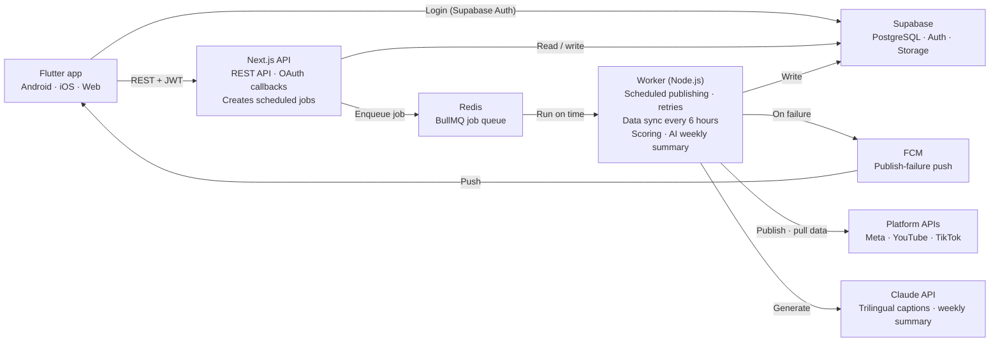

# TRD: Social Media Management Platform

| Field | Value |
|---|---|
| Author | Jaxz Tan |
| Status | Draft |
| Version | 0.1 |
| Last updated | 2026-10-19 |
| Related PRD | PRD-launchx.md |

## 1. Architecture overview

This TRD covers FR-1 to FR-18 in the PRD; FR-19 is deferred. The architecture is monolith-first: one Next.js API plus one background worker, sharing a single TypeScript codebase.



Flutter only calls the Next.js API; long-running tasks such as publishing, data sync, scoring and the AI weekly summary go through the Redis queue to the worker.

## 2. Tech stack & rationale

Flutter on the frontend and Next.js on the backend are the team's decisions; the other layers are recommendations, marked "(recommended)". Key point: scheduled publishing and data sync need long-running background jobs, which don't belong inside Next.js API requests, so a separate worker is used.

| Layer | Choice | Why | Alternative |
|---|---|---|---|
| Frontend | Flutter (Android / iOS / Web) | Team decision; one codebase, three platforms | — |
| Backend API | Next.js Route Handlers (TypeScript) | Team decision; serves a REST JSON API to Flutter | — |
| Background jobs | Node.js worker + BullMQ (recommended) | Handles scheduled publishing, retries, data sync; shares TypeScript code with Next.js | Upstash QStash |
| Queue / cache | Redis (recommended) | Required by BullMQ; also usable for API rate-limit counters | — |
| Database | PostgreSQL (Supabase) + Prisma (recommended) | Relational data fits users, accounts, posts, metrics; Prisma gives TypeScript type safety | Neon |
| Auth | Supabase Auth (recommended) | Official Flutter SDK; Next.js only needs to verify the JWT | Firebase Auth |
| Media storage | Supabase Storage (recommended) | The Instagram API reads media from a publicly accessible URL when publishing | AWS S3 |
| AI | Claude API (recommended) | Generates trilingual weekly summaries and captions | — |
| Push notifications | Firebase Cloud Messaging (recommended) | Mature Flutter support; used for publish-failure alerts | — |
| Deployment | Railway: one service each for Next.js and the worker (recommended) | Both services run continuously; one platform is simpler to manage | Fly.io |

## 3. Platform integration

Every platform follows the same three steps: OAuth to get a token → publish content → pull data periodically. All three platforms require review before content can be published publicly.

| Platform | APIs used | Review & limits | Demo handling |
|---|---|---|---|
| Facebook + Instagram | Meta Graph API (one Meta app covers both) | Instagram supports Business / Creator accounts only; Advanced Access needs App Review + Business Verification; max 100 API posts per account per rolling 24 hours ([Meta](https://developers.facebook.com/docs/instagram-platform/content-publishing), [bundle.social](https://bundle.social/blog/instagram-graph-api)) | Team test accounts, running in development mode |
| YouTube | YouTube Data API v3 (upload) + YouTube Analytics API (data) | Videos uploaded by unverified projects created after 28 July 2020 are locked to private; requires the Audit and Quota Extension form ([YouTube API](https://developers.google.com/youtube/v3/docs/videos/insert)). Reported upload quota cost varies online; confirm in Cloud Console ([RapidDev](https://www.rapidevelopers.com/md/api-automations/how-to-automate-youtube-video-uploads-using-the-api)) | Private video uploads to a test channel |
| TikTok | Content Posting API (Direct Post) | Unaudited clients: max 5 posting users per 24 hours, accounts must be private, content visible only to the poster ([TikTok](https://developers.tiktok.com/doc/content-sharing-guidelines)) | Private test account |

Design principle: each platform is an adapter implementing the same interface (`connect`, `publish`, `fetchMetrics`, `refreshToken`), so adding a platform doesn't touch core logic.

## 4. Unified Content Score specification

Score = the post's weighted engagement rate, expressed as a percentile (0–100) among the same account's last 30 posts on the same platform. Weights are a first draft and configurable.

1. Take raw metrics: views, likes, comments, shares, saves. A metric a platform doesn't provide is treated as missing, not 0, and its weight is removed from the denominator (so platforms without saves aren't penalised).
2. Calculate the weighted engagement rate:

   ```
   ER = (w_l·likes + w_c·comments + w_s·shares + w_v·saves) / views
        × (Σ w_all / Σ w_available)
   ```

3. Initial weights: likes 1, comments 2, shares 3, saves 3.
4. Same-age comparison: older posts accumulate more data, so store a snapshot at 48 hours and at 7 days after publishing, and only compare against historical snapshots at the same point.
5. Percentile: Score = percentile rank of ER within the baseline set (same account, same platform, same snapshot point, last 30 posts).
6. Cold start: if the baseline set has fewer than 5 posts, show "Collecting data" instead of a score (maps to FR-9).

All raw metrics and every calculation result are stored, so historical scores can be recalculated after the formula changes.

## 5. Data model & API

Only seven core entities; `metric_snapshots` is append-only and serves as the audit trail for scores.

| Entity | Key fields | Relations |
|---|---|---|
| users | id, email, language, persona (sme / creator) | A user has many brands |
| brands | id, user_id, name | A brand has many social_accounts |
| social_accounts | id, brand_id, platform, external_id, access_token (encrypted), refresh_token (encrypted), expires_at, status | Belongs to a brand |
| posts | id, brand_id, caption_base, media_url, scheduled_at, created_at | A post has many post_targets |
| post_targets | id, post_id, social_account_id, caption_override, status, external_post_id, error, published_at | One row per platform |
| metric_snapshots | id, post_target_id, snapshot_type (48h / 7d / latest), views, likes, comments, shares, saves, fetched_at | Append-only |
| content_scores | id, post_target_id, snapshot_type, er, score, weights_version, computed_at | Recalculable with new weights |

Main API (all endpoints require login; Flutter calls them with a Supabase JWT):

| Method | Path | Purpose | Maps to FR |
|---|---|---|---|
| GET | /api/accounts/{platform}/connect | Start OAuth | FR-2, FR-3, FR-4 |
| GET | /api/accounts/{platform}/callback | OAuth callback; store token encrypted | FR-2, FR-3, FR-4 |
| POST | /api/posts | Create a post and schedule it to multiple platforms | FR-5, FR-6 |
| GET | /api/posts?from=&to= | Calendar view | FR-6, FR-7 |
| GET | /api/dashboard | Scores per platform, trends, top 3 posts | FR-10 |
| GET | /api/posts/{id}/metrics | Single post raw data and score breakdown | FR-11 |
| POST | /api/ai/captions | Generate trilingual captions | FR-13 |
| GET | /api/insights/weekly | Latest weekly summary | FR-12 |

## 6. Technical requirements

Every Must and Should in the PRD maps to at least one TR.

| ID | Technical requirement | Implements | Notes |
|---|---|---|---|
| TR-1 | Supabase Auth handles sign-up and login; Next.js middleware verifies the JWT | FR-1 | |
| TR-2 | One adapter per platform implementing connect / publish / fetchMetrics / refreshToken | FR-2, FR-3, FR-4 | TikTok adapter connects only to test accounts in the demo |
| TR-3 | Worker periodically refreshes tokens close to expiry; on failure, marks the account as needing reconnection | FR-2, FR-3, FR-4 | |
| TR-4 | Media is uploaded to Supabase Storage first, then passed to platform APIs as a public URL | FR-5 | |
| TR-5 | Creating a post creates one BullMQ delayed job per target platform, which runs publish at the scheduled time | FR-6, NFR-2 | |
| TR-6 | Failed publishes retry 3 times with exponential backoff; if still failing, write the error and push via FCM | FR-7, NFR-2 | |
| TR-7 | Worker syncs metrics every 6 hours, and also triggers snapshots at 48 hours and 7 days after publishing | FR-8 | Watch platform API rate limits |
| TR-8 | After a snapshot is written, calculate ER and the percentile score and store in content_scores | FR-9 | Spec in section 4 |
| TR-9 | Dashboard API aggregates scores and trends; results cached in Redis for 10 minutes | FR-10, NFR-1 | |
| TR-10 | Single-post API returns raw metrics, weights and calculation breakdown | FR-11 | |
| TR-11 | Every Monday the worker aggregates data and calls the Claude API to generate a summary in the user's chosen language | FR-12 | Demo can use pre-generated output |
| TR-12 | Caption API calls the Claude API to output trilingual captions | FR-13 | |
| TR-13 | Flutter manages BM, Chinese and English strings with intl / ARB files | FR-15, NFR-6 | |
| TR-14 | Subscription billing integrates a local payment gateway | FR-18 | Choose before launch; not in demo |
| TR-15 | Tokens encrypted with AES-256-GCM; key kept in environment variables, never in the database or sent to the client | NFR-3 | |
| TR-16 | Provide a "delete account" API that deletes all user data and revokes platform authorisations | NFR-4 | |

## 7. Security, compliance & risks

The security priority is protecting platform tokens: whoever has a token can control the user's social account.

- Auth: every API requires a Supabase JWT; every request checks that the resource belongs to the user's brand.
- Secrets: platform app secrets, the encryption key and the Claude API key live only in server environment variables.
- Input validation: all API requests validated with Zod; uploads restricted by file type and size.
- Rate limiting: Redis counters limit AI and publish requests per user, to stay within platform quotas.
- Data retention: store only data needed for publishing and analytics; delete all data when a user deletes their account (TR-16).

| Risk | Likelihood | Impact | Mitigation |
|---|---|---|---|
| Platform review fails or takes too long | Medium | High | Submit Meta, YouTube and TikTok reviews early; launch with whichever platforms pass first |
| Platform API rules or quotas change | Medium | High | Adapters isolate per-platform logic; monitor API error rates |
| A platform lacks metrics needed for scoring | Medium | Medium | Formula already handles missing metrics (section 4) |
| Scheduled jobs missed | Low | High | BullMQ persistence + retries + failure push |
| Token leak | Low | High | Encrypted storage (TR-15), periodic key rotation |

### Build sequence

The critical path is "account connection → data pull → scoring"; it decides whether the demo can show the core value. The Flutter UI can be built in parallel with the backend, using mock data first.

1. Supabase project, Prisma schema, Next.js skeleton, auth (S)
2. Meta adapter: OAuth + data pull (M)
3. Content Score calculation + dashboard API (M)
4. Flutter: login, account connection, dashboard (M, parallel with 2–3)
5. Publishing & scheduling: worker + BullMQ + Meta publishing (M)
6. YouTube adapter, then TikTok test account (M)
7. AI captions and weekly summary (S)
8. Pre-demo smoke test: connect accounts, schedule one post to three platforms, see a score, see a failure alert
