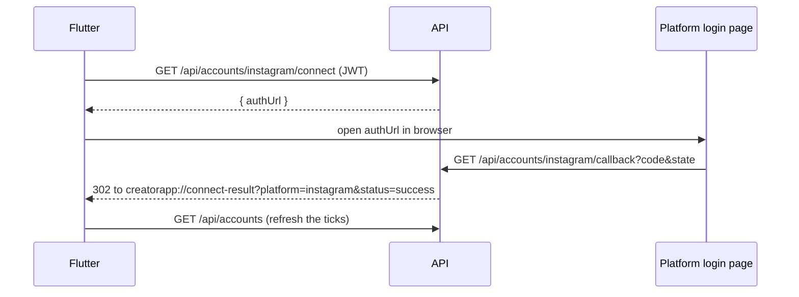

# API Contract: M1 (Account Connection and Data Pull)

| Field | Value |
|---|---|
| Owners | Jayci (backend), Jaxz (Flutter) |
| Milestone | M1 |
| Based on | TRD v1.3 §5, Jayci TRD v2.0 §6 and §12, `backend/prisma/schema.prisma` |
| Status | Draft, waiting for Jaxz to confirm |
| Version | 0.1 |
| Last updated | 2026-10-21 |

This is the agreement between the Next.js API and the Flutter app. Flutter builds every M1 screen against the example JSON here; the backend returns exactly this shape. **Any change is agreed by both sides first, never a silent edit.** Bump the version and add a line to the changelog at the end.

---

## 1. Global rules

These apply to every endpoint.

### 1.1 Base URL

| Environment | Base URL |
|---|---|
| Local (Android emulator) | `http://10.0.2.2:3000` |
| Local (iOS simulator / web) | `http://localhost:3000` |
| Staging | `https://<app>.up.railway.app` (filled in after the B1 deploy) |

Flutter reads it from `--dart-define=API_URL=...`, as `frontend/lib/main.dart` already does.

### 1.2 Authentication

Every endpoint except `/api/health` and the OAuth callbacks needs the Supabase access token:

```
Authorization: Bearer <supabase access token>
```

The callback is opened by the browser, which cannot send this header. The server finds the user through the OAuth `state` instead (section 3).

### 1.3 Format

| Rule | Example |
|---|---|
| JSON field names are **camelCase** | `publishedAt`, not `published_at` |
| Dates are ISO 8601 strings in **UTC** | `"2026-10-21T09:00:00Z"` |
| IDs are UUID strings (ours) or plain strings (platform IDs) | `"6f1c2a8e-..."` |
| A metric the platform does not give is **`null`, never `0`** | `"saves": null` |
| An optional text field with no value is `null`, not `""` | `"caption": null` |
| Request bodies are JSON with `Content-Type: application/json` | |

Why `null` and not `0`: the Content Score removes the weight of a missing metric (TRD §4). A `0` would look like real data and pull the score down.

### 1.4 Platform values

`platform` is always one of: `"youtube"`, `"facebook"`, `"instagram"`.

### 1.5 Error shape

Every error, on every endpoint, returns this body with a matching HTTP status:

```json
{
  "error": {
    "code": "NOT_FOUND",
    "message": "Account not found"
  }
}
```

- `code` is stable and in UPPER_SNAKE_CASE. Flutter switches on `code`.
- `message` is for developers and logs. It is English and may change. **Do not show it to users**; map `code` to a translated string (TR-13).

| HTTP | `code` | When |
|---|---|---|
| 400 | `VALIDATION_ERROR` | Bad query or body (wrong `platform`, `limit` out of range, missing field) |
| 401 | `UNAUTHORIZED` | No token, bad token or expired token |
| 404 | `NOT_FOUND` | Resource does not exist **or belongs to another user** (we never reveal which) |
| 409 | `ACCOUNT_NEEDS_RECONNECT` | The platform token stopped working; user must reconnect |
| 410 | `STATE_EXPIRED` | Page picker `state` is missing, used or older than 10 minutes |
| 422 | `NO_SELECTABLE_PAGE` | The chosen `pageId` is not in the picker list |
| 502 | `PLATFORM_ERROR` | Instagram / Facebook / YouTube API failed; safe to retry later |
| 500 | `INTERNAL_ERROR` | Anything else |

Tokens never appear in any response or error message (NFR-3).

---

## 2. Endpoint list

| # | Method | Path | Auth | Purpose | Maps to |
|---|---|---|---|---|---|
| 1 | GET | `/api/health` | No | Server is up | B1 |
| 2 | GET | `/api/accounts` | Yes | Connected accounts with status | FR-2, FR-3, FR-4 |
| 3 | GET | `/api/accounts/{platform}/connect` | Yes | Get the OAuth login URL | FR-2, FR-3, FR-4 |
| 4 | GET | `/api/accounts/{platform}/callback` | No (uses `state`) | OAuth return; redirects to the app | FR-2, FR-3, FR-4 |
| 5 | GET | `/api/accounts/facebook/pages?state=` | Yes | List Pages to pick from | FR-4 |
| 6 | POST | `/api/accounts/facebook/pages` | Yes | Connect the chosen Page | FR-4 |
| 7 | GET | `/api/posts?platform=&limit=` | Yes | Imported posts with latest metrics | FR-8 |

Endpoints 2, 5 and 6 are not in the TRD API table yet (see section 6).

---

## 3. OAuth hand-off (connect flow)

Flutter cannot attach a JWT to a browser redirect, so connect is split into a JSON call and a browser step.



### 3.1 Deep link

After the callback, the API redirects the browser to:

```
creatorapp://connect-result?platform=<platform>&status=<status>[&reason=<reason>][&state=<state>]
```

> **To confirm with Jaxz:** the scheme `creatorapp://` is a placeholder. Jaxz picks the real one for F5; the backend reads it from the `APP_DEEP_LINK` env var, so changing it needs no code change.

| `status` | Extra params | Flutter does |
|---|---|---|
| `success` | none | Refresh `GET /api/accounts`, show the green tick |
| `choose_page` | `state` | Facebook only. Open the Page picker with this `state` (section 4.5) |
| `error` | `reason` | Show the message for `reason` |

| `reason` | Meaning | Suggested message |
|---|---|---|
| `cancelled` | User pressed Cancel on the login page | "Connection cancelled." |
| `invalid_state` | Link too old or already used | "Something went wrong. Please try again." |
| `not_professional` | Instagram account is personal | "Switch your Instagram to a Creator or Business account, then try again." |
| `no_page` | Facebook user manages no Page (or none with insights access) | "You need a Facebook Page to connect. Reels can only be read from Pages." |
| `platform_error` | Platform API failed | "Instagram/Facebook/YouTube is not responding. Please try again later." |

---

## 4. Endpoints

### 4.1 `GET /api/health`

No auth. Used to check the deploy.

**200**
```json
{
  "status": "ok",
  "time": "2026-10-21T09:00:00.000Z"
}
```

### 4.2 `GET /api/accounts`

Lists the user's connected accounts. Used by the Connect screen for the ticks and the Reconnect button. A platform that is not in the list is not connected.

**200**
```json
{
  "accounts": [
    {
      "id": "6f1c2a8e-3b4d-4c5e-9f60-1a2b3c4d5e6f",
      "platform": "instagram",
      "displayName": "makanwithmei",
      "status": "active",
      "connectedAt": "2026-10-28T03:10:00Z",
      "lastSyncedAt": "2026-10-28T06:00:00Z"
    },
    {
      "id": "0a9b8c7d-6e5f-4a3b-8c2d-1e0f9a8b7c6d",
      "platform": "facebook",
      "displayName": "Makan with Mei",
      "status": "expired",
      "connectedAt": "2026-10-28T03:12:00Z",
      "lastSyncedAt": null
    }
  ]
}
```

| Field | Type | Notes |
|---|---|---|
| `id` | string (UUID) | Our account ID |
| `platform` | string | Section 1.4 |
| `displayName` | string \| null | Instagram username, Facebook Page name or YouTube channel title |
| `status` | `"active"` \| `"expired"` \| `"revoked"` | Anything other than `active` → show **Reconnect** |
| `connectedAt` | string (date) | First connected |
| `lastSyncedAt` | string (date) \| null | `null` = first pull not finished yet → show "Syncing…" |

No account yet → `{ "accounts": [] }`.

### 4.3 `GET /api/accounts/{platform}/connect`

Starts OAuth. Also used for **Reconnect**: connecting again updates the same account row.

**200**
```json
{
  "authUrl": "https://www.instagram.com/oauth/authorize?client_id=...&redirect_uri=...&response_type=code&scope=...&state=..."
}
```

Flutter opens `authUrl` in the system browser (or an in-app browser tab) and waits for the deep link. The URL is valid for 10 minutes.

**Errors:** `400 VALIDATION_ERROR` (unknown platform), `401 UNAUTHORIZED`.

### 4.4 `GET /api/accounts/{platform}/callback`

Called by the platform, **not by Flutter**. Listed here so both sides know the redirect URIs to register in the Meta app and Google Cloud:

```
https://<api-host>/api/accounts/instagram/callback
https://<api-host>/api/accounts/facebook/callback
https://<api-host>/api/accounts/youtube/callback
```

Always answers `302` to the deep link in section 3.1, never JSON, even on error.

### 4.5 `GET /api/accounts/facebook/pages?state=<state>`

Called after the deep link returns `status=choose_page`. Lists the Pages the user can connect. Returns names only, **never Page tokens**.

**200**
```json
{
  "pages": [
    { "id": "102938475610293", "name": "Makan with Mei" },
    { "id": "564738291056473", "name": "Mei Bakes" }
  ]
}
```

| Field | Type | Notes |
|---|---|---|
| `pages[].id` | string | Facebook Page ID. Send it back in 4.6 |
| `pages[].name` | string | Show this in the picker |

**Errors:** `400 VALIDATION_ERROR` (no `state`), `401 UNAUTHORIZED`, `410 STATE_EXPIRED`, `404 NOT_FOUND` (the `state` belongs to another user).

### 4.6 `POST /api/accounts/facebook/pages`

Connects the Page the user picked. The `state` can be used once.

**Request**
```json
{
  "state": "9f86d081884c7d659a2feaa0c55ad015a3bf4f1b2b0b822cd15d6c15b0f00a08",
  "pageId": "102938475610293"
}
```

**201**: the connected account, same shape as one item in 4.2.
```json
{
  "account": {
    "id": "0a9b8c7d-6e5f-4a3b-8c2d-1e0f9a8b7c6d",
    "platform": "facebook",
    "displayName": "Makan with Mei",
    "status": "active",
    "connectedAt": "2026-10-28T03:12:00Z",
    "lastSyncedAt": null
  }
}
```

**Errors:** `400 VALIDATION_ERROR`, `401 UNAUTHORIZED`, `404 NOT_FOUND`, `410 STATE_EXPIRED`, `422 NO_SELECTABLE_PAGE`.

### 4.7 `GET /api/posts?platform=<platform>&limit=<n>`

The user's imported posts with their **latest** metric snapshot. Used by the F6 post list (raw numbers only in M1; Content Score comes in M2).

| Query | Required | Default | Rule |
|---|---|---|---|
| `platform` | No | all platforms | Section 1.4 |
| `limit` | No | `30` | Integer 1 to 50 |

Sorted by `publishedAt`, newest first.

**200**
```json
{
  "posts": [
    {
      "id": "a91b3c5d-7e9f-4a1b-8c3d-5e7f9a1b3c5d",
      "platform": "facebook",
      "caption": "Nasi lemak under RM5 in PJ",
      "mediaType": "FB_REEL",
      "permalink": "https://www.facebook.com/reel/1234567890",
      "publishedAt": "2026-10-15T11:00:00Z",
      "metrics": {
        "views": 9120,
        "likes": 402,
        "comments": 31,
        "shares": 27,
        "saves": null
      },
      "metricsFetchedAt": "2026-10-28T06:00:00Z"
    },
    {
      "id": "b72c4d6e-8f0a-4b2c-9d4e-6f8a0b2c4d6e",
      "platform": "instagram",
      "caption": null,
      "mediaType": "REELS",
      "permalink": "https://www.instagram.com/reel/AbC123/",
      "publishedAt": "2026-10-27T13:30:00Z",
      "metrics": {
        "views": null,
        "likes": null,
        "comments": null,
        "shares": null,
        "saves": null
      },
      "metricsFetchedAt": null
    }
  ]
}
```

| Field | Type | Notes |
|---|---|---|
| `id` | string (UUID) | Our post ID (`post_targets.id`) |
| `platform` | string | Section 1.4 |
| `caption` | string \| null | |
| `mediaType` | string | `"REELS"` or `"FEED"` (Instagram), `"FB_REEL"` (Facebook), `"SHORT"` or `"VIDEO"` (YouTube) |
| `permalink` | string \| null | Opens the post on the platform |
| `publishedAt` | string (date) | |
| `metrics.*` | integer \| null | `null` = platform does not give it, or not fetched yet. Facebook `saves` is always `null` |
| `metricsFetchedAt` | string (date) \| null | `null` = no snapshot yet. Instagram data can lag up to 48 hours, so show "Collecting data" |

No posts → `{ "posts": [] }`.

**Errors:** `400 VALIDATION_ERROR`, `401 UNAUTHORIZED`.

---

## 5. Mock data for Flutter

Until the real endpoints are live, Flutter uses the example responses in section 4 as fixtures. Cover these cases on the screens:

| Screen | Case | Mock |
|---|---|---|
| Connect | Nothing connected | `{ "accounts": [] }` |
| Connect | One active, one needs reconnect | Example in 4.2 |
| Connect | First sync running | `lastSyncedAt: null` |
| Connect | Each deep-link `reason` | Table in 3.1 |
| Page picker | Two Pages | Example in 4.5 |
| Page picker | Took too long | `410 STATE_EXPIRED` |
| Post list | Mixed platforms, Facebook `saves: null` | Example in 4.7 |
| Post list | New post, no metrics yet | Second item in 4.7 |
| Any | Logged out | `401 UNAUTHORIZED` |

---

## 6. Open points

| # | Question | For |
|---|---|---|
| 1 | Deep link scheme to replace `creatorapp://` | Jaxz |
| 2 | Add `GET /api/accounts` and the two Page picker routes to the TRD API table | Jaxz |
| 3 | The TRD `GET /api/posts?from=&to=` (calendar, M3) and this M1 `GET /api/posts?platform=&limit=` share a path. Proposal: keep one endpoint and accept both sets of filters | Jaxz |
| 4 | Schema (B2): `metric_snapshots.views/likes/comments/shares` are `NOT NULL`, which breaks the `null` rule in 1.3. Make them nullable | Jayci, in B2 |
| 5 | Schema (B2): `post_targets.post_id` and `posts.caption_base`, `media_url`, etc. are required, but imported posts have no `posts` row. Needs nullable `post_id` plus `caption`, `media_type`, `permalink` on `post_targets` | Jayci, in B2 |
| 6 | Schema uses `expired` / `revoked` instead of `needs_reconnect`. Contract follows the schema; Flutter treats both as "Reconnect" | Agreed in 4.2 |

---

## Changelog

| Version | Date | Change |
|---|---|---|
| 0.1 | 2026-10-21 | First draft for M1 |
