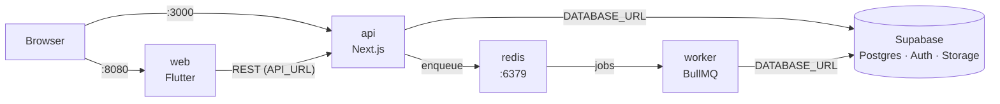

# Docker setup

How the whole repo runs in Docker: services, ports, files, commands and common fixes.

Architecture follows [TRD §1](./TRD.md#1-architecture-overview): Flutter → Next.js API → Redis queue → worker. Database, Auth and Storage are **remote Supabase**, so there is no database container.

## Quick start

```sh
make dev     # watch mode: hot reload for Next.js, worker and Flutter
make         # production-like build (same as `make up`)
make help    # list every command
```

Then open:

| What | URL |
|---|---|
| Flutter web app | http://localhost:8080 |
| Next.js API | http://localhost:3000 |
| API health check | http://localhost:3000/api/health |

**Before the first run:** `.env` must exist at the repo root (see [Environment variables](#environment-variables)).

## Services



| Service | Source | Dev target (`make dev`) | Prod target (`make`) | Host port → container | Depends on |
|---|---|---|---|---|---|
| `api` | `backend/` | `dev`: `next dev` | `api`: standalone `node server.js` | `3000 → 3000` | redis (healthy) |
| `worker` | `backend/` | `dev`: `tsx watch src/worker/index.ts` | `worker`: `tsx src/worker/index.ts` | none | redis (healthy) |
| `redis` | `redis:7.4-alpine` | same | same | `6379 → 6379` | none |
| `web` | `frontend/` | `dev`: `flutter run -d web-server` | `web`: nginx serving `build/web` | dev `8080 → 8080`, prod `8080 → 80` | api |

### Ports at a glance

| Port | Service | Notes |
|---|---|---|
| 3000 | api | Next.js API, the only backend Flutter talks to |
| 8080 | web | Flutter web. In dev it's the Flutter dev server, in prod it's nginx |
| 6379 | redis | Exposed so you can run `npm run worker` or `redis-cli` from your Mac |
| 5432 | Supabase (remote) | Session pooler. Used by Prisma migrations (`DIRECT_URL`) |
| 6543 | Supabase (remote) | Transaction pooler. Used by the app at runtime (`DATABASE_URL`) |

If a port is already taken on your Mac, change the left side of the mapping in `compose.yaml`, for example `"3001:3000"`.

### Volumes

| Volume | Used by | Holds | Removed by |
|---|---|---|---|
| `redis-data` | redis | queued jobs | `make clean`, `make fclean` |

No database volume: all data lives in Supabase.

## Files

```
.
├── compose.yaml          # base stack, production-like targets
├── compose.dev.yaml      # dev overrides: dev targets + watch rules
├── Makefile              # shortcuts (see below)
├── .env                  # secrets, gitignored, shared by api + worker
├── backend/
│   ├── Dockerfile        # stages: base → deps → dev | build → api | worker
│   ├── .dockerignore
│   ├── prisma.config.ts  # migrations use DIRECT_URL
│   ├── prisma/schema.prisma
│   ├── src/lib/prisma.ts # runtime client uses DATABASE_URL
│   └── src/worker/index.ts
└── frontend/
    ├── Dockerfile        # stages: base → dev | build → web
    ├── .dockerignore
    └── docker/
        ├── dev.sh        # flutter run + auto hot reload on lib/ change
        └── nginx.conf    # SPA fallback to index.html
```

### `backend/Dockerfile` stages

| Stage | From | Does |
|---|---|---|
| `base` | `node:24-bookworm-slim` | installs `openssl` (Prisma needs it) |
| `deps` | base | `npm ci`; `postinstall` runs `prisma generate`. Uses a dummy `DIRECT_URL` because generating the client never connects to the database |
| `dev` | deps | copies source, runs `next dev --hostname 0.0.0.0` |
| `build` | deps | `next build` with `output: "standalone"` (set in `next.config.ts`) |
| `api` | base | copies only `.next/standalone`, `.next/static`, `public`; runs as user `node` |
| `worker` | deps | full source, runs `npm run worker` as user `node` |

### `frontend/Dockerfile` stages

| Stage | From | Does |
|---|---|---|
| `base` | `ghcr.io/cirruslabs/flutter:3.38.7` | enables web, `flutter pub get` (cached layer) |
| `dev` | base | runs `docker/dev.sh` on port 8080 |
| `build` | base | `flutter build web --release --dart-define=API_URL=...` |
| `web` | `nginx:1.27-alpine` | serves `build/web` on port 80 |

The Flutter version is pinned to match the local SDK (3.38.7, Dart ^3.10.7 in `pubspec.yaml`). If you upgrade Flutter locally, bump the tag in `frontend/Dockerfile` too.

## Watch mode (`make dev`)

`make dev` runs:

```sh
docker compose -f compose.yaml -f compose.dev.yaml up --build --watch
```

Compose watches your files and either **syncs** them into the running container or **rebuilds** the image:

| You edit | Action | Result |
|---|---|---|
| `backend/src/**` | sync → `/app/src` | Next.js hot reloads; worker restarts via `tsx watch` |
| `backend/public/**` | sync → `/app/public` | served immediately |
| `backend/next.config.ts` | sync + restart | api container restarts |
| `backend/package.json` | rebuild | new deps installed |
| `backend/prisma/schema.prisma` | rebuild | Prisma client regenerated. **Run `make migrate` too** to change Supabase |
| `frontend/lib/**` | sync → `/app/lib` | `dev.sh` sees the change within 1s and triggers a Flutter hot reload |
| `frontend/pubspec.yaml` | rebuild | new packages fetched |

`backend/src/generated/` is never synced: each container generates its own Prisma client.

**How Flutter hot reload works in Docker:** `flutter run -d web-server` normally waits for you to press `r`. `frontend/docker/dev.sh` feeds Flutter's input from a named pipe and writes `r` to it whenever a file in `lib/` is newer than the last reload. If a change doesn't show up (for example, new `main()` setup), refresh the browser tab or restart the service with `docker compose -f compose.yaml -f compose.dev.yaml restart web`.

## Environment variables

All app config comes from the root `.env`, loaded with `env_file: .env` into `api` and `worker`.

| Variable | Used by | Purpose |
|---|---|---|
| `DATABASE_URL` | api, worker (runtime) | Supabase transaction pooler, port 6543, `?pgbouncer=true` |
| `DIRECT_URL` | Prisma CLI (migrations) | Supabase session pooler, port 5432 |
| `SUPABASE_PASSWORD` | reference only | database password (already inside the URLs, URL-encoded) |
| `NEXT_PUBLIC_SUPABASE_URL` | api | Supabase project URL |
| `NEXT_PUBLIC_SUPABASE_PUBLISHABLE_KEY` | api | Supabase public key |

Set by Compose (not in `.env`):

| Variable | Service | Value |
|---|---|---|
| `REDIS_URL` | api, worker | `redis://redis:6379` (container network name) |
| `NODE_ENV` | api, worker (dev) | `development` |
| `API_URL` | web | `http://localhost:3000`. Passed to Flutter as `--dart-define`; read it with `String.fromEnvironment('API_URL')` |

`API_URL` is `localhost` because Flutter web runs **in your browser**, not inside Docker. For the prod build it is baked in at build time (`args.API_URL` in `compose.yaml`).

## Makefile commands

| Command | Runs | Use when |
|---|---|---|
| `make` / `make up` | `docker compose up --build` | production-like run, all 4 services |
| `make dev` | dev stack with `--watch` | daily development |
| `make down` | stop and remove containers | done for the day |
| `make logs` | follow logs of all services | debugging |
| `make ps` | list services and status | check what's running |
| `make migrate` | `prisma migrate deploy` (on your Mac) | apply new migrations to Supabase |
| `make studio` | `prisma studio` (on your Mac) | browse Supabase data |
| `make clean` | down + remove volumes + images built by this repo | reset Redis data and rebuild from scratch |
| `make fclean` | `clean` + also remove pulled images (node, flutter, redis, nginx) | free disk space. The next build re-downloads about 2 GB |
| `make re` | `fclean` then `up` | full rebuild |

`clean` and `fclean` never touch Supabase: your database is remote.

## Database migrations

Migrations run from your Mac, not inside containers:

```sh
cd backend
npx prisma migrate dev --name <change>   # create + apply a new migration
make migrate                              # apply existing migrations (e.g. after git pull)
```

`prisma.config.ts` loads `../.env` and uses `DIRECT_URL` (port 5432) because the transaction pooler (6543) doesn't support migrations.

## Troubleshooting

| Symptom | Cause | Fix |
|---|---|---|
| `npm ci` fails: `Missing: @emnapi/... from lock file` | lockfile generated on macOS is missing Linux-only packages | regenerate it in Linux: `docker run --rm -v "$PWD/backend:/src" -w /tmp node:24-bookworm-slim sh -c "cp /src/package*.json . && npm install --package-lock-only --ignore-scripts && cp package-lock.json /src/"` |
| `P1000: Authentication failed` | wrong or placeholder password in `DATABASE_URL` / `DIRECT_URL` | put the real password in both URLs, URL-encoded |
| `port is already allocated` | something on your Mac already uses 3000, 8080 or 6379 | stop it, or change the host port in `compose.yaml` |
| Flutter change not showing | hot reload can't apply some changes | refresh the browser, or restart the `web` service |
| api starts before Redis | none: Compose waits for the Redis healthcheck (`redis-cli ping`) | if Redis keeps failing, check `make logs` |
| Disk filling up | old images and build cache | `make fclean`, then `docker builder prune` (removes build cache for **all** projects) |

## Not in Docker (yet)

- **Database / Auth / Storage:** remote Supabase.
- **Android / iOS builds:** run on your Mac with `flutter run`. Docker only serves the web build.
- **Worker logic:** `backend/src/worker/index.ts` is a stub that logs jobs from the `jobs` queue. Real publishing, sync, scoring and summary jobs come in TRD build step 7.
